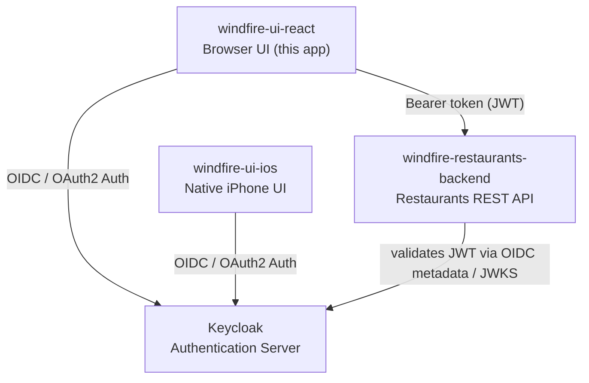

# Windfire UI

A browser-based UI for the Windfire application, built with React 18.

Windfire is designed to integrate different software components in a flexible and future-proof manner. This repository is the web client — one of two UI frontends in the system. It provides a login interface backed by Keycloak authentication and an authenticated dashboard with a top navigation bar, a Restaurants section (list/add/delete backed by a REST API), and a Calendar section (placeholder, coming soon).

## Architecture

The Windfire system consists of two client UIs that share a centralized Keycloak authentication backend, plus at least one backend resource server this app talks to directly.



| Component | Technology | Role |
|---|---|---|
| windfire-ui-react | React 18, Browser | Web-based client UI |
| windfire-ui-ios | Swift / SwiftUI, iPhone | Native mobile client UI |
| Keycloak | Keycloak Server | Centralized identity and access management |
| windfire-restaurants-backend | Spring Boot | REST API backing the Restaurants section (`REACT_APP_RESTAURANTS_URL`) |

### Application Structure

```
windfire-ui-react/
├── public/                       # Static assets (index.html, icons, manifest)
├── src/
│   ├── auth/
│   │   ├── keycloakService.js      # Keycloak token & logout API calls
│   │   └── AuthContext.js          # React Context for global auth state
│   ├── components/
│   │   ├── LoginForm.js / .css     # Login form (username/password + error display)
│   │   ├── HomePage.js / .css      # Authenticated shell: renders Header/body/Footer, page routing
│   │   ├── Header.js / .css        # Top nav bar: logo, Restaurants/Calendar links, user + sign out
│   │   ├── Footer.js / .css        # Footer bar
│   │   ├── RestaurantsPage.js / .css  # Restaurants list, add form, delete, detail modal
│   │   ├── PlaceholderPage.js / .css  # "Coming soon" placeholder (used for Calendar)
│   │   ├── WindfireLogo.js         # Inline SVG Windfire wordmark/flame logo
│   │   └── ArchitectureDiagram.js  # Inline SVG system architecture diagram (not currently rendered)
│   ├── App.js                    # Root component: routes between LoginForm and HomePage
│   ├── App.css / index.css       # Global styles
│   ├── setupProxy.js             # CRA dev-server proxy: /keycloak/* → KEYCLOAK_PROXY_TARGET
│   └── index.js                  # React entry point
├── ssl/
│   ├── generate-ssl.sh            # Script to generate self-signed key + certificate
│   ├── windfire-key.pem           # TLS private key (not committed — see .gitignore)
│   └── windfire-cert.pem          # TLS certificate (not committed — see .gitignore)
├── server.js                     # Production HTTPS server (Express + Node https), optional /keycloak proxy
├── start.sh                      # Build/run helper script (production or --dev mode)
├── commons.sh                    # Shared terminal color codes sourced by start.sh / ssl/generate-ssl.sh
├── KEYCLOAK_HTTPS_PLAN.md        # Working notes on migrating Keycloak/backend to HTTPS
├── .env_PLACEHOLDER              # Template for required environment variables
└── .env                          # Local environment config (not committed)
```

### Authentication Flow

This app uses the **OIDC Resource Owner Password Credentials** grant (direct credentials flow):

1. The user submits username and password via `LoginForm`.
2. `keycloakService.js` POSTs to `{KEYCLOAK_URL}/realms/{REALM}/protocol/openid-connect/token` with `grant_type=password`.
3. Keycloak returns an access token and a refresh token (both JWTs).
4. The access token is decoded client-side to extract the user's display name (`name`, `preferred_username`).
5. Tokens are stored in `sessionStorage` under the key `wf_auth` (cleared on browser close).
6. On logout, the refresh token is invalidated by POSTing to Keycloak's logout endpoint, then session storage is cleared.

`App.js` renders `LoginForm` when unauthenticated and `HomePage` once authentication succeeds.

### Application Features

`HomePage` renders a persistent `Header` (logo, **Restaurants** / **Calendar** nav links, signed-in user name, sign-out button) and `Footer`, with the body switching by selected page:

| Page | Component | Behavior |
|---|---|---|
| Home | `WindfireLogo` | Default landing view — just the Windfire logo. |
| Restaurants | `RestaurantsPage` | Fetches restaurants from `REACT_APP_RESTAURANTS_URL` with the Keycloak access token as a `Bearer` header; supports adding a restaurant (name, address, cuisine, contact info), deleting one (with confirm step), and viewing full details in a modal. |
| Calendar | `PlaceholderPage` | "Coming soon" placeholder — not yet implemented. |

The Restaurants section requires a running instance of the `windfire-restaurants-backend` API (or compatible service) reachable at `REACT_APP_RESTAURANTS_URL`, accepting `GET` / `POST` / `DELETE` with a Keycloak-issued bearer token.

---

## Keycloak Setup

The following configuration must be present in Keycloak before the application can authenticate users.

### 1. Create a Realm

Create a realm named **`windfire`** (this must match `REACT_APP_KEYCLOAK_REALM` in `.env`).

### 2. Create a Client

Inside the `windfire` realm, create a client with the following settings:

| Setting | Value |
|---|---|
| Client ID | `windfire` (must match `REACT_APP_KEYCLOAK_CLIENT_ID`) |
| Client type | OpenID Connect |
| Client authentication | Off (public client — no client secret) |
| Standard flow | Optional (not used by this app) |
| Direct access grants | **Enabled** (required — this app uses the password grant) |
| Valid redirect URIs | `https://localhost/*`, `https://localhost:3000/*`, `https://raspberry02:8443/*` |
| Web origins | `https://localhost`, `https://localhost:3000`, `https://raspberry02:8443` |

> **Why public + Direct Access Grants?** This is a browser SPA with no server-side component, so it cannot safely hold a client secret. The password grant posts credentials directly to Keycloak from the browser.

> If deploying to a non-localhost URL, add that URL to **Valid redirect URIs** and **Web origins** as well.

### 3. Create Users

In the `windfire` realm, create at least one user:

- Go to **Users → Add user** and set a username.
- Under the **Credentials** tab, set a password and set **Temporary** to **Off** so the user is not forced to reset on first login.

### 4. Configure Environment Variables

Copy `.env_PLACEHOLDER` to `.env` and fill in the values:

```bash
cp .env_PLACEHOLDER .env
```

```
REACT_APP_KEYCLOAK_REALM=windfire
REACT_APP_KEYCLOAK_CLIENT_ID=windfire
REACT_APP_RESTAURANTS_URL=<restaurants-backend-endpoint>
```

For reaching Keycloak itself, `.env_PLACEHOLDER` offers **two mutually exclusive solutions** — pick one:

| Solution | When to use | Variables |
|---|---|---|
| 1. HTTPS proxy | Keycloak only serves HTTP; avoid a mixed-content error by proxying it through this app's own server. | `REACT_APP_KEYCLOAK_URL=/keycloak`, `KEYCLOAK_PROXY_TARGET=<keycloak-http-url>` |
| 2. Direct HTTPS | Keycloak already serves HTTPS end-to-end. | `REACT_APP_KEYCLOAK_URL=<keycloak-https-url>` |

Solution 1 is implemented by `setupProxy.js` (dev server) and the `/keycloak` proxy in `server.js` (production server): both forward `/keycloak/*` requests to `KEYCLOAK_PROXY_TARGET`, so the browser only ever talks to this app's own origin over HTTPS and `KEYCLOAK_PROXY_TARGET` is never bundled into the client build.

> `.env` is listed in `.gitignore` — do not commit it.

---

## Development

### Prerequisites
- Node.js 16+
- npm 8+
- A running Keycloak instance configured as described above
- A running `windfire-restaurants-backend` (or compatible API) if you need the Restaurants page to work
- A `.env` file with the required variables set (see above)

### Available Scripts

#### `npm start`
Runs the app in development mode at [http://localhost:3000](http://localhost:3000).

#### `npm test`
Launches the test runner in interactive watch mode.

#### `npm run build`
Builds the app for production to the `build` folder.

#### `npm run serve`
Starts the production HTTPS server (`server.js`) to serve the `build` folder.
Requires `SSL_KEY_FILE` and `SSL_CRT_FILE` to be set (or defaults in `ssl/`).

#### `npm run eject`
**Note: this is a one-way operation. Once you eject, you can't go back.**

Exposes the underlying Webpack, Babel and ESLint configuration for full control.

### `start.sh` helper script

`start.sh` wraps the scripts above: it installs dependencies if `node_modules` is missing, then either builds and serves the production app or launches the dev server.

```bash
./start.sh              # build + start the production HTTPS server (npm run build && npm run serve)
./start.sh --dev         # start the dev server (npm start)
./start.sh -h            # show usage
```

---

## HTTPS / SSL Setup

HTTPS is enforced using SSL certificates. The app supports two modes:

| Mode | Command | Server | Use case |
|---|---|---|---|
| Production | `./start.sh` | `server.js` (Node `https` + Express) | Real deployments |
| Development | `./start.sh --dev` | CRA webpack-dev-server | Local dev with HTTPS |

### SSL Certificate Generation

SSL key and certificate files are stored in the `ssl/` directory (excluded from version control). A helper script is provided to generate a self-signed pair for local development:

```bash
bash ssl/generate-ssl.sh
```

This creates `ssl/windfire-key.pem` (RSA 4096-bit private key) and `ssl/windfire-cert.pem` (valid 365 days, CN=localhost). The script is a no-op if both files already exist — delete them and re-run to regenerate.

> **Self-signed certificates trigger browser security warnings.** For production, replace these files with certificates issued by a trusted Certificate Authority (e.g. [Let's Encrypt](https://letsencrypt.org/)).

`start.sh` calls `ssl/generate-ssl.sh` automatically (in production mode) if `ssl/windfire-key.pem` or `ssl/windfire-cert.pem` is not found before the build starts.

### Production Mode (default)

`./start.sh` builds the React app and starts the HTTPS server:

- HTTPS on port `443` (override with `PORT=<n>` in `.env`)
- HTTP redirect on port `80` (override with `HTTP_PORT=<n>`, disable with `HTTP_REDIRECT=false`)

```bash
./start.sh
```

> **Port 443 requires elevated privileges on Linux.** For non-root deployments, set `PORT=8443` (and optionally `HTTP_PORT=8080`) and place a reverse proxy (nginx, load balancer) in front.

### Development Mode

`./start.sh --dev` starts the CRA webpack-dev-server. To enable HTTPS in dev mode, set the following in your `.env`:

```
HTTPS=true
SSL_KEY_FILE=ssl/windfire-key.pem
SSL_CRT_FILE=ssl/windfire-cert.pem
```

Then run:

```bash
./start.sh --dev
```

The dev server will be available at `https://localhost:3000`.

### SSL Environment Variables

| Variable | Default | Description |
|---|---|---|
| `SSL_KEY_FILE` | `ssl/key.pem`* | Path to TLS private key file |
| `SSL_CRT_FILE` | `ssl/cert.pem`* | Path to TLS certificate file |
| `PORT` | `443` | HTTPS server port |
| `HTTP_PORT` | `80` | HTTP redirect server port |
| `HTTP_REDIRECT` | `true` | Set to `false` to disable HTTP→HTTPS redirect |

\* These are `server.js`'s built-in fallbacks if the variables are unset. In practice, always set `SSL_KEY_FILE`/`SSL_CRT_FILE` explicitly in `.env` (as `.env_PLACEHOLDER` does) to `ssl/windfire-key.pem` / `ssl/windfire-cert.pem`, matching the filenames produced by `ssl/generate-ssl.sh` and checked by `start.sh`.

### Keycloak Redirect URI Update for HTTPS

When switching from HTTP to HTTPS, update the Keycloak client's **Valid redirect URIs** and **Web origins** to use `https://`, covering every real origin the app is served from:

| Setting | HTTP value | HTTPS value |
|---|---|---|
| Valid redirect URIs | `http://localhost:3000/*` | `https://localhost/*`, `https://localhost:3000/*`, `https://raspberry02:8443/*` |
| Web origins | `http://localhost:3000` | `https://localhost`, `https://localhost:3000`, `https://raspberry02:8443` |

> The app will fail to authenticate if the redirect URIs in Keycloak still point to `http://` after switching to HTTPS.
>
> **Web Origins matters even for the password grant.** This app doesn't use the redirect flow, but its `fetch()` call to Keycloak's token endpoint is still a cross-origin request from the browser. Keycloak only sends `Access-Control-Allow-Origin` for origins listed in the client's Web Origins — without it, the response fails with a CORS error in the browser console even though the same request via curl or Postman succeeds.

### Trusting Keycloak's self-signed certificate

Keycloak's HTTPS listener currently serves a **self-signed certificate**. Until the machine/browser running this app trusts the CA that issued it, `fetch()` calls to Keycloak will fail outright with `TypeError: Failed to fetch` — before CORS or credentials are even evaluated.

1. Get the CA certificate (`ca_keycloak.pem`) — pull it from the Keycloak host, e.g.:
   ```bash
   scp raspberry01:~/dev/windfire-security/keycloak/security/tls/ca_keycloak.pem /tmp/ca_keycloak.pem
   ```
2. Trust it at the OS level so all browsers on the machine pick it up:
   - **macOS**:
     ```bash
     sudo security add-trusted-cert -d -r trustRoot \
       -k /Library/Keychains/System.keychain /tmp/ca_keycloak.pem
     ```
   - **Linux**:
     ```bash
     sudo cp ca_keycloak.pem /usr/local/share/ca-certificates/ca_keycloak.crt
     sudo update-ca-certificates
     ```
     Firefox keeps its own certificate store (NSS) separate from the OS — import the CA cert manually via `about:preferences#privacy` → **View Certificates** → **Authorities** → **Import** if Firefox is used.

Repeat this on every machine a browser is used against this app — the dev Mac, and `raspberry02` if a browser is ever pointed directly at it.

> See [KEYCLOAK_HTTPS_PLAN.md](KEYCLOAK_HTTPS_PLAN.md) for the working notes on migrating Keycloak and the Restaurants backend to HTTPS end-to-end, including the mixed-content proxy rationale above.
