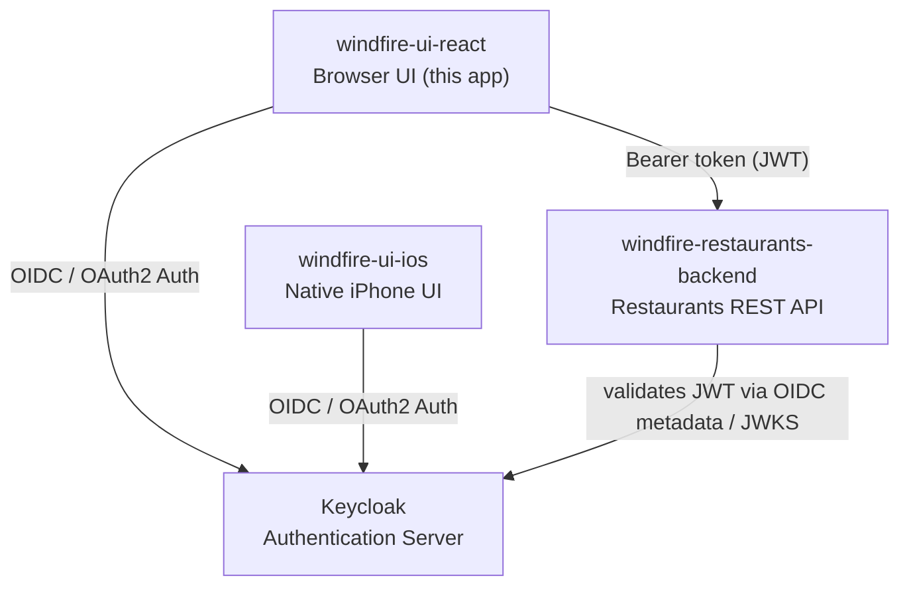

# Windfire UI
[](https://github.com/robipozzi/windfire-ui-react/actions/workflows/ci.yml)

A browser-based UI for the Windfire application, built with React 18 and Vite.

Windfire is designed to integrate different software components in a flexible and future-proof manner. This repository is the web client — one of two UI frontends in the system. It provides a login interface backed by Keycloak authentication and an authenticated dashboard with a top navigation bar, a Restaurants section (list/add/delete backed by a REST API), and a Calendar section (placeholder, coming soon).

## Architecture

The Windfire system consists of two client UIs that share a centralized Keycloak authentication backend, plus at least one backend resource server this app talks to directly.



| Component | Technology | Role |
|---|---|---|
| windfire-ui-react | React 18, Browser | Web-based client UI |
| windfire-ui-ios | Swift / SwiftUI, iPhone | Native mobile client UI |
| Keycloak | Keycloak Server | Centralized identity and access management |
| windfire-restaurants-backend | Spring Boot | REST API backing the Restaurants section (`VITE_RESTAURANTS_URL`) |

### Application Structure

```
windfire-ui-react/
├── .github/                      # dependabot.yml and the CI workflow (workflows/ci.yml)
├── index.html                    # Vite entry page (loads src/index.jsx)
├── vite.config.mjs               # Vite and Vitest configuration, dev server port and HTTPS
├── public/                       # Static assets copied as is to dist/ (icons, manifest)
├── src/
│   ├── auth/
│   │   ├── keycloak.js             # The single keycloak-js instance and its init (PKCE)
│   │   └── AuthContext.jsx         # React Context: auth state, getToken(), logout()
│   ├── components/
│   │   ├── HomePage.jsx / .css     # Authenticated shell: renders Header/body/Footer, page routing
│   │   ├── Header.jsx / .css       # Top nav bar: logo, Restaurants/Calendar links, user + sign out
│   │   ├── Footer.jsx / .css       # Footer bar
│   │   ├── RestaurantsPage.jsx / .css # Restaurants list, add form, delete, detail modal
│   │   ├── PlaceholderPage.jsx / .css # "Coming soon" placeholder (used for Calendar)
│   │   ├── WindfireLogo.jsx        # Inline SVG Windfire wordmark/flame logo
│   │   └── ArchitectureDiagram.jsx # Inline SVG system architecture diagram (not currently rendered)
│   ├── App.jsx                   # Root component: AuthProvider around HomePage
│   ├── App.css / index.css       # Global styles
│   └── index.jsx                 # React entry point
├── ssl/
│   ├── generate-ssl-cert.sh       # Issues a key + certificate signed by the Windfire Root CA
│   ├── windfire-ui.key            # TLS private key, default name (not committed — see .gitignore)
│   └── windfire-ui.crt            # TLS certificate, default name (not committed — see .gitignore)
├── server.js                     # Production HTTPS server (Express + Node https), security headers (helmet: CSP, HSTS, nosniff, Referrer-Policy, COOP; Permissions-Policy), cache headers
├── start.sh                      # Build/run helper script (production or --dev mode)
├── commons.sh                    # Shared colors, variables and functions sourced by the shell scripts
├── deployment/
│   ├── deploy.sh                 # Build locally and deploy to the frontend Ansible host group
│   ├── undeploy.sh               # Remove the deployment from the frontend Ansible host group
│   └── raspberry/                # Ansible playbooks, tasks, templates and conf/config.yaml
├── KEYCLOAK_HTTPS_PLAN.md        # Working notes on migrating Keycloak/backend to HTTPS
├── .env_PLACEHOLDER              # Template for required environment variables
└── .env                          # Local environment config (not committed)
```

### Authentication Flow

This app uses the **OIDC Authorization Code flow with PKCE (S256)** through [`keycloak-js`](https://www.npmjs.com/package/keycloak-js). The app never sees the user's password:

1. On load, `AuthProvider` calls `keycloak.init({ onLoad: 'login-required', pkceMethod: 'S256', checkLoginIframe: false })` and shows "Signing you in…" until it completes.
2. Without a Keycloak session, the browser is redirected to the Keycloak login page. After sign-in, Keycloak redirects back with an authorization code, which `keycloak-js` exchanges for tokens together with the PKCE code verifier.
3. The user's display name (`name`, `preferred_username`) comes from the access token's claims.
4. Tokens are kept **in memory only** in the `keycloak-js` instance, never in `sessionStorage` or `localStorage`. A page reload goes through a quick redirect to Keycloak, which signs the user in again without a prompt while the Keycloak session lasts. (`keycloak-js` keeps the short-lived PKCE state, nonce and code verifier in `localStorage` during the redirect and deletes them on return. It never stores tokens there.)
5. Before each API call, `getToken()` calls `keycloak.updateToken(30)`, which refreshes the access token when it expires within 30 seconds. If the refresh fails, the user is sent back to the Keycloak login page.
6. Sign out calls `keycloak.logout({ redirectUri: window.location.origin })`, which ends the Keycloak session and returns to the app.

`App.jsx` wraps `HomePage` in `AuthProvider`, which renders it only after sign-in has completed.

### Application Features

`HomePage` renders a persistent `Header` (logo, **Restaurants** / **Calendar** nav links, signed-in user name, sign-out button) and `Footer`, with the body switching by selected page:

| Page | Component | Behavior |
|---|---|---|
| Home | `WindfireLogo` | Default landing view — just the Windfire logo. |
| Restaurants | `RestaurantsPage` | Fetches restaurants from `VITE_RESTAURANTS_URL` with the Keycloak access token as a `Bearer` header; supports adding a restaurant (name, address, cuisine, contact info), deleting one (with confirm step), and viewing full details in a modal. User-supplied websites are rendered as links (`target="_blank"`, `rel="noopener noreferrer"`) only when they parse as absolute `http:`/`https:` URLs (`src/utils/safeUrl.js`); anything else, such as `javascript:` or `data:`, is shown as plain text. Emails get a `mailto:` link only when they match a plain address pattern. |
| Calendar | `PlaceholderPage` | "Coming soon" placeholder — not yet implemented. |

The Restaurants section requires a running instance of the `windfire-restaurants-backend` API (or compatible service) reachable at `VITE_RESTAURANTS_URL`, accepting `GET` / `POST` / `DELETE` with a Keycloak-issued bearer token.

---

## Keycloak Setup

The following configuration must be present in Keycloak before the application can authenticate users.

### 1. Create a Realm

Create a realm named **`windfire`** (this must match `VITE_KEYCLOAK_REALM` in `.env`).

### 2. Create a Client

Inside the `windfire` realm, create a client with the following settings:

| Setting | Value |
|---|---|
| Client ID | `windfire` (must match `VITE_KEYCLOAK_CLIENT_ID`) |
| Client type | OpenID Connect |
| Client authentication | Off (public client — no client secret) |
| Standard flow | **On** (Authorization Code flow) |
| Direct access grants | **Off** (the password grant is not used) |
| Proof Key for Code Exchange Code Challenge Method (*Advanced* tab) | **S256** |
| Valid redirect URIs | Exact URIs, no wildcards: `https://localhost/`, `https://localhost:3000/`, `https://raspberry01:9443/` |
| Valid post logout redirect URIs | `https://localhost`, `https://localhost:3000`, `https://raspberry01:9443` |
| Web origins | `+` (allows the origins of the valid redirect URIs) |

> **Why public + PKCE?** This is a browser SPA, so it cannot keep a client secret. With PKCE, only the browser that started the login can exchange the authorization code for tokens, and users enter their password on Keycloak's own page, never in this app.

> If deploying to another URL, add it to **Valid redirect URIs** and **Valid post logout redirect URIs**.

### 3. Create Users

In the `windfire` realm, create at least one user:

- Go to **Users → Add user** and set a username.
- Under the **Credentials** tab, set a password and set **Temporary** to **Off** so the user is not forced to reset on first login.

### 4. Configure Environment Variables

Copy `.env_PLACEHOLDER` to `.env` and fill in the values:

```bash
cp .env_PLACEHOLDER .env
```

```
VITE_KEYCLOAK_REALM=windfire
VITE_KEYCLOAK_CLIENT_ID=windfire
VITE_RESTAURANTS_URL=<restaurants-backend-endpoint>
```

Keycloak is served over HTTPS and the browser talks to it directly, so set its absolute URL:

```
VITE_KEYCLOAK_URL=<keycloak-https-url>
```

`server.js` refuses to start if `VITE_KEYCLOAK_URL` is relative (for example `/keycloak`, from the old proxy setup, which has been removed).

> `.env` is listed in `.gitignore` — do not commit it.

---

## Development

### Prerequisites
- Node.js 26.13+ (needed locally and in CI to build and test; the Raspberry Pi only runs `server.js`)
- npm 8+
- A running Keycloak instance configured as described above
- A running `windfire-restaurants-backend` (or compatible API) if you need the Restaurants page to work
- A `.env` file with the required variables set (see above)

### Available Scripts

#### `npm run dev`
Runs the Vite dev server at [https://localhost:3000](https://localhost:3000), or over HTTP if the SSL files are missing. `npm start` is an alias.

#### `npm test`
Runs the test suite once with Vitest.

#### `npm run build`
Builds the app for production to the `dist` folder.

#### `npm run serve`
Starts the production HTTPS server (`server.js`) to serve the `dist` folder.
Requires `SSL_KEY_FILE` and `SSL_CRT_FILE` to be set (or defaults in `ssl/`).

### `start.sh` helper script

`start.sh` wraps the scripts above: it installs dependencies if `node_modules` is missing, then either builds and serves the production app or launches the dev server.

```bash
./start.sh              # build + start the production HTTPS server (npm run build && npm run serve)
./start.sh --dev         # start the dev server (npm run dev)
./start.sh -h            # show usage
```

---

## HTTPS / SSL Setup

HTTPS is enforced using SSL certificates. The app supports two modes:

| Mode | Command | Server | Use case |
|---|---|---|---|
| Production | `./start.sh` | `server.js` (Node `https` + Express) | Real deployments |
| Development | `./start.sh --dev` | Vite dev server | Local dev with HTTPS |

### SSL Certificate Generation

SSL key and certificate files are stored in the `ssl/` directory (excluded from version control). A helper script issues a leaf certificate signed by the **Windfire Root CA** (see the sibling `windfire-security` repo):

```bash
bash ssl/generate-ssl-cert.sh
```

In an interactive terminal, the script asks for the environment and for the certificate and key filenames; press Enter to accept the defaults. By default this creates `ssl/windfire-ui.key` (RSA 4096-bit private key) and `ssl/windfire-ui.crt` (valid 365 days, CN=localhost), signed by the Windfire Root CA. Without a terminal, it uses the defaults unless flags are passed. If you choose other filenames for `localhost`, set `SSL_KEY_FILE` and `SSL_CRT_FILE` in `.env` to match. Existing files with the same names are deleted and regenerated.

**Prerequisite:** the Windfire Root CA must already exist. Run `windfire-security/ssl/createRootCA.sh` first if `~/opt/windfire/ssl/truststore/WindfireRootCA.crt` / `~/opt/windfire/ssl/keystore/WindfireRootCA.key` aren't present yet. Since the Root CA key is passphrase-protected, `generate-ssl-cert.sh` will prompt for it while signing.

Flags (all optional):

| Flag | Description | Default |
|---|---|---|
| `-e, --env <localhost\|raspberry>` | Target environment (CN/SAN) | `localhost` |
| `-c, --cert-name <file>` | Output certificate filename (prompted if omitted in a terminal) | `windfire-ui.crt` |
| `-k, --key-name <file>` | Output private key filename (prompted if omitted in a terminal) | `windfire-ui.key` |
| `-a, --ca-name <file>` | Windfire Root CA certificate filename (in the truststore) | `WindfireRootCA.crt` |
| `-h, --help` | Display usage | — |

```bash
# Production cert for raspberry01 (written to ~/opt/windfire/ssl/certs/raspberry)
bash ssl/generate-ssl-cert.sh -e raspberry -c windfire-ui.crt -k windfire-ui.key
```

`deployment/deploy.sh` runs this command for you when the certificate is missing (see [Deployment](#deployment)).

> **The Windfire Root CA is not in the system/browser trust store by default.** It must be trusted separately by any client connecting to this server over HTTPS.

`start.sh` calls `ssl/generate-ssl-cert.sh -e localhost` automatically (in production mode) if the files named by `SSL_KEY_FILE` or `SSL_CRT_FILE` (default `ssl/windfire-ui.key` and `ssl/windfire-ui.crt`) are not found before the build starts. It passes those filenames to the script, so it does not prompt for them, and the script writes them to `ssl/`.

### Production Mode (default)

`./start.sh` builds the React app and starts the HTTPS server:

- HTTPS on port `443` (override with `PORT=<n>` in `.env`)
- HTTP redirect on port `80` (override with `HTTP_PORT=<n>`, disable with `HTTP_REDIRECT=false`)

```bash
./start.sh
```

> **Port 443 requires elevated privileges on Linux.** For non-root deployments, set `PORT=8443` (and optionally `HTTP_PORT=8080`) and place a reverse proxy (nginx, load balancer) in front.

### Development Mode

`./start.sh --dev` starts the Vite dev server. It uses HTTPS automatically when the files named by `SSL_KEY_FILE` and `SSL_CRT_FILE` exist (default `ssl/windfire-ui.key` and `ssl/windfire-ui.crt`). If either is missing, it logs a warning and uses HTTP. Run `ssl/generate-ssl-cert.sh` to create them.

Run:

```bash
./start.sh --dev
```

The dev server will be available at `https://localhost:3000`. The port is fixed, and startup fails if it is taken, because the Keycloak client and the backend CORS configuration expect this origin.

### SSL Environment Variables

| Variable | Default | Description |
|---|---|---|
| `SSL_KEY_FILE` | `ssl/windfire-ui.key`* | Path to TLS private key file |
| `SSL_CRT_FILE` | `ssl/windfire-ui.crt`* | Path to TLS certificate file |
| `PORT` | `443` | HTTPS server port |
| `HTTP_PORT` | `80` | HTTP redirect server port |
| `HTTP_REDIRECT` | `true` | Set to `false` to disable HTTP→HTTPS redirect |

\* These are `server.js`'s built-in fallbacks if the variables are unset. In practice, always set `SSL_KEY_FILE`/`SSL_CRT_FILE` explicitly in `.env` (as `.env_PLACEHOLDER` does) to `ssl/windfire-ui.key` / `ssl/windfire-ui.crt`, matching the default filenames produced by `ssl/generate-ssl-cert.sh`. `start.sh` checks whichever files these variables name.

### Security Headers

`server.js` uses [helmet](https://helmetjs.github.io/) to add these headers to every response from the production server:

| Header | Value |
|---|---|
| `Content-Security-Policy` | `default-src 'self'; script-src 'self'; style-src 'self' 'unsafe-inline'; img-src 'self' data:; connect-src 'self' <keycloak-origin> <restaurants-origin>; frame-ancestors 'none'; object-src 'none'; base-uri 'self'` |
| `Strict-Transport-Security` | `max-age=31536000; includeSubDomains` |
| `X-Content-Type-Options` | `nosniff` |
| `Referrer-Policy` | `no-referrer` |
| `Cross-Origin-Opener-Policy` | `same-origin` |
| `Permissions-Policy` | `camera=(), microphone=(), geolocation=()` |

`X-Powered-By` is disabled. `index.html` (including the SPA fallback for every unknown route) is served with `Cache-Control: no-store`. The content-hashed bundles under `dist/assets/` are served with `Cache-Control: public, max-age=31536000, immutable`.

The `connect-src` origins come from `VITE_KEYCLOAK_URL` and `VITE_RESTAURANTS_URL`, which `server.js` reads once at startup. Run the server with the same `.env` used for `npm run build`, and restart it after changing either URL. Otherwise the browser will block the API calls.

### Keycloak Redirect URI Update for HTTPS

When switching from HTTP to HTTPS, update the Keycloak client's **Valid redirect URIs** and **Web origins** to use `https://`, covering every real origin the app is served from:

| Setting | HTTPS value |
|---|---|
| Valid redirect URIs | `https://localhost/*`, `https://localhost:3000/*`, `https://raspberry01:9443/*` |
| Web origins | `https://localhost`, `https://localhost:3000`, `https://raspberry01:9443` |

> The app will fail to authenticate if the redirect URIs in Keycloak still point to `http://` after switching to HTTPS.
>
> **Web Origins matters even for the password grant.** This app doesn't use the redirect flow, but its `fetch()` call to Keycloak's token endpoint is still a cross-origin request from the browser. Keycloak only sends `Access-Control-Allow-Origin` for origins listed in the client's Web Origins — without it, the response fails with a CORS error in the browser console even though the same request via curl or Postman succeeds.

### Trusting Keycloak's self-signed certificate

Keycloak's HTTPS listener currently serves a **self-signed certificate**. Until the machine/browser running this app trusts the CA that issued it, `fetch()` calls to Keycloak will fail outright with `TypeError: Failed to fetch` — before CORS or credentials are even evaluated.

1. Get the CA certificate (`ca_keycloak.pem`) — pull it from the Keycloak host, e.g.:
   ```bash
   scp raspberry01:~/dev/windfire-security/keycloak/security/tls/ca_keycloak.pem /tmp/ca_keycloak.pem
   ```
2. Trust it at the OS level so all browsers on the machine pick it up:
   - **macOS**:
     ```bash
     sudo security add-trusted-cert -d -r trustRoot \
       -k /Library/Keychains/System.keychain /tmp/ca_keycloak.pem
     ```
   - **Linux**:
     ```bash
     sudo cp ca_keycloak.pem /usr/local/share/ca-certificates/ca_keycloak.crt
     sudo update-ca-certificates
     ```
     Firefox keeps its own certificate store (NSS) separate from the OS — import the CA cert manually via `about:preferences#privacy` → **View Certificates** → **Authorities** → **Import** if Firefox is used.

Repeat this on every machine a browser is used against this app — the dev Mac, and `raspberry01` if a browser is ever pointed directly at it.

> See [KEYCLOAK_HTTPS_PLAN.md](KEYCLOAK_HTTPS_PLAN.md) for the working notes on migrating Keycloak and the Restaurants backend to HTTPS end-to-end, including the mixed-content proxy rationale above.

### Running locally against the Restaurants API

When the app runs locally, the Restaurants page may show `Failed to load restaurants: Cannot reach the Restaurants API (network, certificate or CORS error).`, and Safari's console reports `Preflight response is not successful. Status code: 403` (Chrome: `Failed to fetch` with a CORS error).

The cause is CORS. Because the `Authorization` header is sent, the browser first sends an `OPTIONS` preflight carrying the app's origin. The backend rejects any origin missing from its `CORS_ALLOWED_ORIGINS` with `403` and no `Access-Control-Allow-Origin` header. The deployed backend on `raspberry02:8081` only allows `https://raspberry01:9443`, so a local origin such as `https://localhost` or `http://localhost:3000` is rejected there. The access token is not the problem: the same request via curl or Postman succeeds.

To develop locally, run the Restaurants backend locally as well:

1. In `windfire-restaurants-backend`, run `./start-windfire-restaurants-backend.sh`. Its default CORS origin is `https://localhost`, where `./start.sh` serves this app. If you use `./start.sh --dev` (port 3000), enter `http://localhost:3000` (or `https://localhost:3000` with dev HTTPS) at the CORS prompt instead.
2. In `.env`, set:
   ```
   VITE_RESTAURANTS_URL=https://localhost:8081/restaurants
   ```
3. Start (or restart) the app with `./start.sh`. `VITE_*` values are read only at start or build time.

You can check the preflight on its own:
```bash
curl -sk -o /dev/null -D - -X OPTIONS https://localhost:8081/restaurants \
  -H 'Origin: https://localhost' \
  -H 'Access-Control-Request-Method: GET' \
  -H 'Access-Control-Request-Headers: authorization'
```
Expect `200` with `Access-Control-Allow-Origin: https://localhost`. A `403` means the origin is not in `CORS_ALLOWED_ORIGINS`.

---

## Dependency monitoring and CI

### CI

The badge at the top of this page shows the latest [CI workflow](.github/workflows/ci.yml) run on `main`; click it to see all runs. The workflow runs on every pull request and on every push to `main`:

* installs the dependencies from the lock file (`npm ci`), using the same Node.js major version as the Raspberry Pi (`nodejs_version` in [conf/config.yaml](deployment/raspberry/conf/config.yaml))
* runs the tests (`npm test`)
* fails on production dependencies with high or critical vulnerabilities (`npm audit --omit=dev --audit-level=high`)
* on pull requests only, fails if the pull request adds a dependency with a high or critical vulnerability (dependency review)

### Dependabot

[Dependabot](.github/dependabot.yml) checks the npm dependencies and the GitHub Actions used by the workflow every week. Minor and patch updates are grouped into one pull request for each of the two, major updates get their own pull requests, and each of the two has at most 5 version update pull requests open at a time.

To read the alerts, go to the **Security** tab of the repository and open **Dependabot** (https://github.com/robipozzi/windfire-ui-react/security/dependabot; you need access to the repository's security alerts). Each alert shows the affected package and file, the severity, the advisory and the first patched version, and links to the Dependabot pull request if there is one.

---

## Deployment

The [deployment/](deployment/) folder contains scripts that run Ansible playbooks against the `frontend` host group of your Ansible inventory (`/etc/ansible/hosts`, i.e. `raspberry01`), using the SSH key `$HOME/.ssh/ansible_rsa`. The app runs on the Pi as the `windfire-ui-react` systemd service, serving HTTPS on port **9443** (raspberry01 already uses `8443` for Keycloak and `8444` for windfire-security; `80`/`443` are left to nginx). The HTTP→HTTPS redirect listener is disabled. The scripts work from any folder.

```bash
deployment/deploy.sh [1] [--full]   # 1 = Raspberry; --full also upgrades packages and installs Node.js
deployment/undeploy.sh [1] [-y]     # -y skips the confirmation prompt (not the sudo password)
deployment/deploy.sh --help
```

Run `deploy.sh --full` the first time (raspberry01 has no Node.js yet); later deploys only need `deploy.sh`.

### What you need before deploying
* Ansible (`ansible-playbook`) and Node.js/npm installed locally, and the SSH key `$HOME/.ssh/ansible_rsa`
* the sudo password of user `pi` on the Pi: sudo is not passwordless, so every playbook run asks for it as `BECOME password` ([ansible.cfg](deployment/raspberry/ansible.cfg) sets `become_ask_pass`)
* `rsync` both locally and on the Pi (used by the Ansible `synchronize` module)
* the Windfire Root CA in `$HOME/opt/windfire/ssl/truststore` (create it with `windfire-security/ssl/createRootCA.sh`)
* a local `.env` (copy `.env_PLACEHOLDER`): its values are offered as defaults

### What `deploy.sh` does
1. **Pre-flight checks**: checks for `ansible-playbook`, `npm`, the SSH key and the Windfire Root CA, and stops with a red error if one is missing. It then asks for the server certificate and key filenames (defaults `windfire-ui.crt` / `windfire-ui.key`). If those files are missing from `$HOME/opt/windfire/ssl/certs/raspberry`, it runs [generate-ssl-cert.sh](ssl/generate-ssl-cert.sh) `-e raspberry` (CN/SAN `raspberry01`).
2. **Configuration**: asks for `VITE_KEYCLOAK_URL`, `VITE_KEYCLOAK_REALM`, `VITE_KEYCLOAK_CLIENT_ID`, `VITE_RESTAURANTS_URL` (defaults from your local `.env`; the Restaurants URL defaults to `https://raspberry02:8081/restaurants` when `.env` has no value or a localhost one), asks again for `VITE_KEYCLOAK_URL` if it is relative (e.g. `/keycloak`, which `server.js` would refuse), and warns about values pointing at `localhost`. These values end up in the JavaScript bundle and are public: never put secrets in them.
3. **Build**: runs `npm ci && npm run build` locally with those values (they override `.env`). The Pi never builds the app.
4. **Playbook**: asks for the `pi` sudo password (`BECOME password`), then runs [windfire-ui-react-deploy.yaml](deployment/raspberry/windfire-ui-react-deploy.yaml) (or [windfire-ui-react-full-deploy.yaml](deployment/raspberry/windfire-ui-react-full-deploy.yaml) with `--full`, which first runs `apt` update/dist-upgrade and installs Node.js `26.x` from NodeSource), configured via **[conf/config.yaml](deployment/raspberry/conf/config.yaml)**:
   1. checks that Node.js 26 or later is installed on the Pi, and stops the `windfire-ui-react` service
   2. removes and recreates `/home/pi/windfire-ui-react`, and copies only `dist/`, `server.js`, `package.json` and `package-lock.json`
   3. builds `.env` from [windfire-ui-react.env.j2](deployment/raspberry/templates/windfire-ui-react.env.j2) (port, TLS paths, the two URLs used for the CSP `connect-src`; mode `0600`)
   4. copies the server certificate (`0644`) and key (`0600`) to `ssl/`, and the Windfire Root CA to `/home/pi/opt/windfire/ssl/truststore`
   5. runs `npm ci --omit=dev` (only `express`, `helmet` and `dotenv` are installed)
5. **systemd**: installs the unit from [windfire-ui-react.service.j2](deployment/raspberry/templates/windfire-ui-react.service.j2), then enables and starts the service. systemd restarts it 5 seconds after a failure and starts it at boot. Logs go to `/home/pi/windfire-ui-react/logs/windfire-ui-react.log`.
6. **Health check**: waits for port 9443 and calls `https://raspberry01:9443/`, checking the certificate against the Windfire Root CA. If the check fails, it prints the last 50 lines of the journal and of the service log, and the deploy fails.

Re-run `deploy.sh` whenever the code or a `VITE_*` value changes: every deploy rebuilds the bundle and replaces the remote folder.

### What `undeploy.sh` does
After confirmation, it runs [windfire-ui-react-undeploy.yaml](deployment/raspberry/windfire-ui-react-undeploy.yaml): stops and disables the service, removes its systemd unit and deletes `/home/pi/windfire-ui-react`. Node.js and the shared Windfire Root CA are left in place.

### After the first deploy
* Add `https://raspberry01:9443/*` to the Keycloak client's **Valid redirect URIs** and `https://raspberry01:9443` to its **Web origins** (see [Keycloak Redirect URI Update for HTTPS](#keycloak-redirect-uri-update-for-https)), and allow the same origin in the Restaurants API CORS configuration.
* Trust the Windfire Root CA in the browsers that open `https://raspberry01:9443`.
* If a firewall is active on raspberry01 (e.g. `ufw`), allow TCP port 9443.
